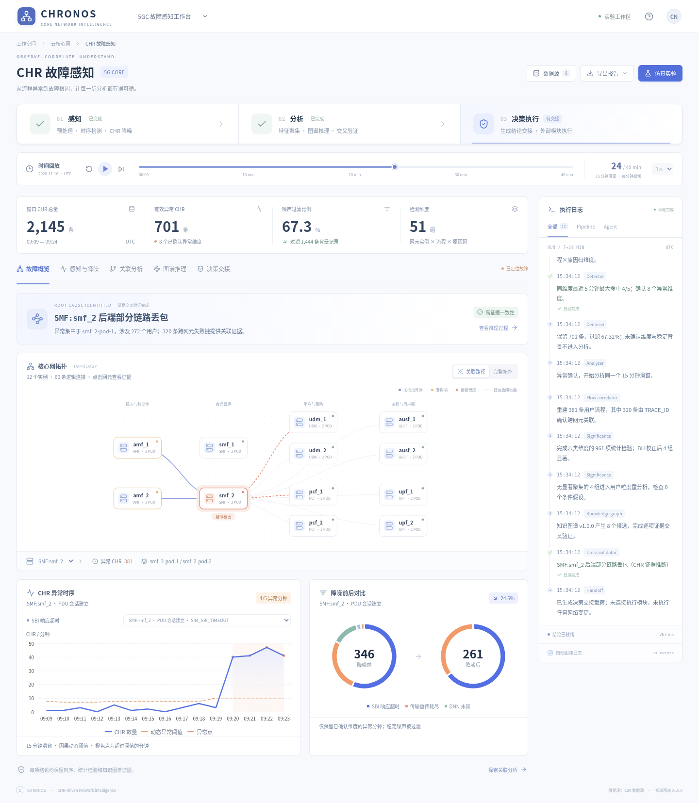

# CHRONOS · 5GC CHR 故障感知与分析

基于 `main-chr-gpt` / `419d94d` 实现的可运行前后端原型。FastAPI + React / TypeScript + ECharts，白底分析工作台，包含分钟回放、降噪、六维聚集性检验、用户失败链、知识图谱交叉验证和决策交接。



## 快速启动

需要 Python 3.12+、Node.js 20.19+ / 22+。仓库已经包含 seed=42 的 40 分钟 CSV、拓扑和图谱，可直接使用。

```bash
python3 -m venv .venv
.venv/bin/pip install -r requirements.lock.txt
cd frontend
npm ci
npm run build
cd ..
bash scripts/start.sh
```

打开 **http://127.0.0.1:8010**；API 文档在 **http://127.0.0.1:8010/docs**。启动脚本默认仅监听本机，通过 `CHR_HOST`、`CHR_PORT` 调整。前端构建由 FastAPI 同源提供，不需要额外 Web 服务器。

开发模式启动后端 `.venv/bin/uvicorn backend.app.main:app --port 8010 --reload`，另一个终端执行 `cd frontend && npm run dev`，访问 `http://127.0.0.1:5173`。Vite 将 API 请求代理到 8010。

## 默认案例

- 40 分钟秒级 CHR；六类网元各 2 实例、每实例 2 POD；不同类型 full mesh，共 12 节点 / 60 边。
- 前 20 分钟正常噪声，T+20:00 起向 `SMF:smf_2` 后端部分路径注入故障。
- 每分钟感知、15 分钟窗口、同一维度最近 5 分钟至少 4 次异常才确认；首次确认 **T+24:00**。
- 默认 T+24 窗口：**2,145 条 → 701 条，过滤 67.32%；51 个时序维度、8 个已确认异常维度；320 条精确跨网元失败链**。
- 输出 `SMF:smf_2 后端部分链路丢包（CHR 证据推断）`，并定位 `smf_2-pod-1`。依据来自数据，实验真值不参与推理。
- 恢复方案建议新会话经过 `SMF:smf_1` 的候选可达路径；执行前仍需核验健康和容量。系统只生成交接，不执行网络操作。

界面可切换时间、点击网元、切换检测维度、点击散点钻取、检索用户路径、查看多候选图谱推理、导出 Markdown / JSON。仿真实验支持正常噪声、两分钟尖峰、持续故障和修改种子/故障实例。

## 重新生成数据

```bash
.venv/bin/python -m backend.app.simulation --seed 42 --scenario packet_loss
# 写到独立目录，避免覆盖正在使用的数据
.venv/bin/python -m backend.app.simulation --seed 7 --scenario normal --output runtime/normal
.venv/bin/python -m backend.app.simulation --scenario transient --output runtime/transient
.venv/bin/python -m backend.app.simulation --fault-instance SMF:smf_1 --output runtime/smf1
```

仿真 CLI 只在拓扑文件不存在时生成默认拓扑。Web 上创建实验只改变内存运行，不覆盖 CSV。`SIM_*` 是明确标注的仿真内部码，NAS 标准码单独使用 `5GMM:* / 5GSM:*` 命名空间。

## 验证

```bash
.venv/bin/python -m pytest backend/tests -q
cd frontend
npm run build
# 先运行 8010 后端和 5173 前端；默认使用系统 Chromium
npx playwright test
```

浏览器测试默认 `/usr/bin/chromium`，可以通过 `CHR_CHROMIUM_PATH` 指定已安装的兼容 Chromium。用例覆盖工作流、时间确认边界、图表筛选、聚类证据、用户路径、下载、仿真实验、桌面/手机布局。截图保存在 `docs/artifacts/`。后端 API 集成测试需要本地事件循环通信；受限执行沙箱需允许本地通信。

## 文档与替换接口

- [实施计划](docs/PLAN.md)
- [调研依据与界面策略](docs/RESEARCH.md)
- [算法、数据字段、时间语义、API、内网替换与边界](docs/ARCHITECTURE.md)
- [验证记录](docs/VALIDATION.md)

内网替换入口：`CHR_DATA_DIR`、`CHR_TOPO_FILE`、`CHR_KG_FILE`，以及 `backend/app/` 中独立的算法模块。内部错误码通过知识图谱的 `signals` 映射语义，可在不修改仿真代码判断的情况下替换。

当前是可复现的离线分钟回放原型；慢推理只保留真实的未执行待办接口，决策执行模块未实现。统计占比不代表业务失败率，CHR 推断也不等同于已测得链路丢包率。
