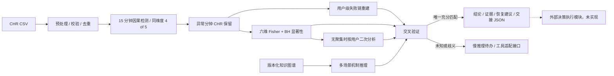

# 架构、算法与内网替换

## 执行链



Python 模块的边界：`ingestion.py`（标准化）、`detection.py`（时序）、`flows.py`（用户链）、`clustering.py`（显著性）、`reasoning.py`（图谱/交叉验证/恢复）、`engine.py`（编排）、`main.py`（API）。前端通过 SSE 接收每个实际阶段的事件和最终快照。

## 数据契约

`data/data.csv` 是 SMF 文件，`amf.csv / ausf.csv / udm.csv / pcf.csv / upf.csv` 分别存放其他网元类型。每类两实例，每实例两个 POD。

| 字段 | 语义 / 处理 |
|---|---|
| Timestamp / 时间戳 | 秒级 ISO 时间；无时区时按 UTC 解释，有时区转换到 UTC |
| Inner Cauce / Inner Cause / 原因码 | 接受用户指定的拼写；标准 NAS 建议保留命名空间 |
| Procedure / 流程标记 | PduSessionEstablishment、ServiceRequest、InitialRegistration；兼容中文名称 |
| IMSI | 始终按字符串保留，禁止丢失前导零或科学计数法 |
| NF_ID / 网元实例 | 统一为 `SMF:smf_2` 等标识，须与拓扑一致 |
| RAN_ID、POD_ID | 必需维度 |
| CELL_ID、REGION_ID | 为用户要求的小区/区域分析补充，缺失则显示数据不足，不伪造 |
| TRACE_ID | 推荐提供的业务关联字段；缺失时采用有界时间候选关联 |
| PEER_NF_ID | 实际被调用的后端实例；缺失时相应路径证据不足，进入慢推理 |
| Last_*_id / Serving_*_ID | 自动识别扩展列，兼容 `Serving PCF ID`；不是固定三列 |

AMF 注册仅写 UDM 路径；PDU 写完整路径；ServiceRequest 不写 Last 路径列。SMF 写 Serving 路径。额外的用户位置与 Trace 字段是仿真补充，后续内网需从 CHR 或关联元数据提供。

无效时间、缺字段、异常 IMSI 被隔离，质量报告最多列出 20 个问题定位。重复行按完整规范化字段与路径去重，包括跨文件重复。没有 Trace ID 的完全相同行可能是采集重复，也可能是同秒真实事件，内网应提供唯一事件 ID/Trace ID 并按产品契约调整去重策略。

`topo/topo.csv` 包含 source、target。12 个实例，不同网元类型任意实例两两连接，共 60 条无向逻辑边。这是按需求构造的 full mesh 逻辑图，不表示每一对都存在标准 5GC 接口。真实部署应替换为实际服务依赖和接口连接。

`experiment.json` 是独立实验注释（种子、故障实例、注入时间）。**Engine 不读取它，算法输入中无故障标签。**

## 时间、检测与降噪

前 20 个完整分钟为正常阶段，从 T+20:00 开始注入。API `minute=24` 表示截至 T+24:00，不含该时刻之后的数据；分析窗口为 `[T+09:00, T+24:00)`。异常分钟分别为 `[20,21)、[21,22)、[22,23)、[23,24)`，在 T+24 满足 4/5，因此延迟为 4 分钟。

每个 `(NF_ID, Procedure, cause)` 独立形成分钟计数序列。前 15 分钟预热。阈值为以下最大值：

- 最低数量 6；
- `median + 4.5 × 1.4826 × MAD`；
- `Poisson(max(median,0.25))` 的 `1 - 0.001/当前已知维度数` 分位数。

中位数与 MAD 来自此前最多 15 个分钟位置，排除已经被判为异常的分钟。至少有 5 个正常历史点时更新阈值，否则保留最后一次正常阈值，以避免持续故障被滚动统计吸收。长期漂移或维护后需要显式重新建立正常基线；生产版应扩展基线生命周期和恢复确认机制。

最近 5 分钟 **同一维度** 至少 4 个分钟超阈值才确认。分析保留当前已确认维度在当前 15 分钟窗口内被标为异常的记录；不保留整个维度所有时刻，也不按固定原因码黑名单过滤。报告明确展示检测维度数、候选/确认数、过滤百分比和分母。

快照回放可预计算完整序列，但每个阈值和判断均使用因果前缀；前缀截断测试保证没有未来数据泄漏。当前为离线 CSV 分钟回放，不是 Kafka 消费者或常驻真实时钟调度器。

## 聚集性与用户流程

每个异常分组检验用户、基站、小区、区域、网元、POD 六类维度。对每个特征值构造：

```
[[异常样本命中该值, 异常样本其他值],
 [背景样本命中该值, 背景样本其他值]]
```

执行 Fisher 单侧富集检验；全部特征假设统一做 BH-FDR 校正。支持度 ≥ 5、q < 0.05、lift ≥ 1.8 才标为显著；其中 q < 0.001 且 lift ≥ 3 标为强显著。Lift 的背景概率使用 Jeffreys 平滑；Fisher 表保持原始整数。

背景来自当前已确认故障最早异常分钟之前的 15 分钟，不随持续故障向前污染。网元维度在同类网元同流程跨实例比较，避免组内必然 100% 的伪聚集；同原因码历史足够时优先使用同码背景，新码不足时使用该流程的 CHR 分布，并标注替代范围。

未发现聚集的分组按 `(网元,流程,原因码,用户)` 重新分组，对同用户的故障前背景检验基站、小区、区域和 POD。用户本人和所在网元已是条件，不再次检验其必然出现的比例。未达到最小用户支持度时明确返回未解决。

本原型是可解释的特征富集/显著性分析，不使用无监督 embedding 聚类。相同用户重试之间可能不独立；CHR 背景不是完整业务暴露量，q 值不能解释成因果概率，比例也不能当作失败率。生产环境应提供成功业务流量与用户会话层采样，校准流量偏置和相关性。

流程优先以 `(IMSI, Procedure, TRACE_ID)` 连接，按时间顺序输出 `SMF cause → AMF cause`。无 Trace 时用同用户同流程 5 秒锚定窗口；多个相同源或冲突实例标为歧义，仅候选关联，不计入强证据。

## 图谱与交叉验证

JSON 中 `codes[].scenarios` 表达一对多关系，`signals` 表达产品错误点的语义证据，`scenarios[].requirements / critical` 定义该机制需要的特征。**替换产品码时通过 signals 映射，无须修改仿真码字符串判断。** 文件载入时检查场景、信号及关键证据引用。

当前链路丢包模型需要：来源实例富集、单 POD 富集、跨用户/接入域分散、两个后端类型、精确上游失败链、重传耗尽信号。每项按公开布尔证据判定；分数是覆盖率，不是训练模型的概率。重要前提必须成立、覆盖率 ≥ 80%，只允许一个充分匹配，且其他解释不能在 0.12 覆盖分差内接近。未知原因码也触发慢推理。

后端链路只标记支持度 ≥ 5 且占该源已知后端异常 ≥ 10% 的主要目标，避免夹杂的低频偶发超时扩大路径范围。该过滤门槛是路径展示/证据支持规则，不是丢包率估计。

此案例支持的结论是“SMF:smf_2 后端部分链路丢包（CHR 证据推断）”。仅凭超时/重传无法测得真实丢包率或排除所有主机网络栈问题，内网需进一步用链路探测验证。慢推理目前返回 `user_trace / colored_probe / configuration_diff` 三类未执行待办；没有 LLM 调用、没有伪造的工具结果。

## 恢复与交接

链路/网元场景从拓扑选择同类型、当前窗口未检出异常、可达相关后端的替代实例。本例为 `AMF:amf_1/2 → SMF:smf_1 → UDM:udm_1 / PCF:pcf_1`。建议对新会话避开故障路径、按会话连续性策略排空旧会话、修复后探测和逐步放量。拓扑可达且没检出 CHR 异常不等于已验证实时健康，执行方仍需核验容量、可达性和亲和关系。

配置场景输出修正或回退到最近验证正常配置的建议，不凭 CHR 虚构配置字段和值。证据不足输出补充跟踪/拨测建议。交接载荷保留 `delivered=false`、`decision_execution_implemented=false`，只提供下载接口，不向外部系统发送。

## API 与内网集成

| 接口 | 用途 |
|---|---|
| `GET /api/health` | 服务健康 |
| `GET /api/meta?run_id=default` | 数据质量、拓扑统计、图谱和参数 |
| `GET /api/snapshot?minute=24&run_id=default` | 任意已完成分钟的分析快照 |
| `GET /api/events?minute=24&run_id=default` | SSE `log / result / pipeline_error` |
| `POST /api/runs` | 创建隔离的仿真数据集；seed、scenario、fault_instance |
| `POST /api/reload` | 重新读取配置文件，成功后原子替换默认数据集 |
| `GET /api/report?minute=24&format=json或markdown` | 下载完整证据或文字报告 |
| `/docs` | OpenAPI 交互文档 |

替换本地文件后点“数据源→重新加载 CSV”，或启动时设置 `CHR_DATA_DIR / CHR_TOPO_FILE / CHR_KG_FILE`。加载失败保留旧数据集。不要把真实数据路径与仿真输出目录指向同一个位置后运行仿真命令。

需要替换算法时保持 `Detector.snapshot`、`analyze_clusters`、`cross_validate` 输出契约；字段格式以 TypeScript `types.ts` 和 OpenAPI 为准。后续实时模式可在 ingestion 前增加 Kafka/文件增量流，在编排层增加真实一分钟调度与 watermark，在同一后端模块执行算法。

当前运行态与快照缓存保存在单进程内存，最多保留 8 个额外实验；进程重启后额外实验丢失。默认 CSV 可重新加载。当前为单工作区原型，不含多租户鉴权、持久任务队列或生产级容量规划；内网上线应在既有网关/身份系统后部署，并按实测体量替换内存存储。没有依赖公网 LLM 或运行时 CDN。
